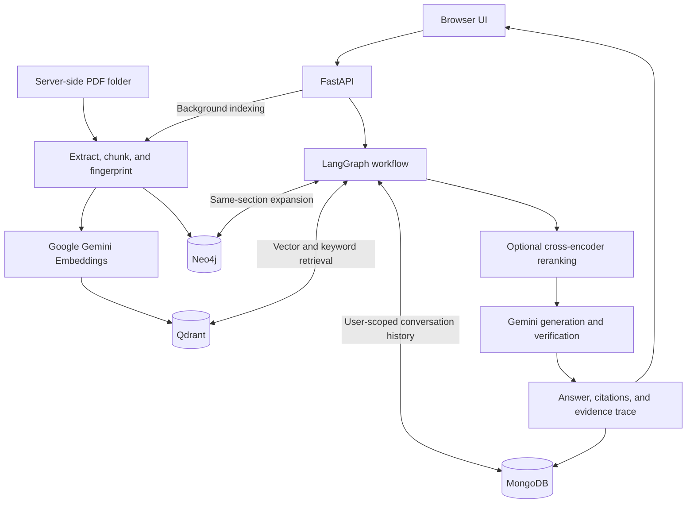

# Nexus | Evidence-Driven RAG Workspace

**Turn a folder of PDFs into a searchable knowledge workspace with cited answers,
conversational context, and inspectable retrieval evidence.**

Nexus is a full-stack retrieval-augmented generation (RAG) application built with
**Python, FastAPI, LangGraph, and Google Gemini**. It combines semantic search,
keyword retrieval, graph-based context expansion, and cross-encoder reranking to
ground answers in indexed documents.

The project demonstrates applied AI engineering beyond a chat interface: document
ingestion, retrieval algorithms, multi-database design, workflow orchestration,
failure handling, and evidence verification.

> **Project scope:** A local demonstration application, not a production-ready
> service. Demo identities are not authentication, and evidence-support scores are
> not guarantees of correctness.

[Technology & skills](#technology--skills) |
[Architecture](#architecture) |
[Quick start](#quick-start) |
[Tests](#tests) |
[Interview walkthrough](#interview-walkthrough) |
[Limitations](#limitations--next-steps)

## What it does

- **Answers questions about PDFs** with source citations and page/chunk inspection.
- **Offers three retrieval modes:** vector-only, hybrid, and hybrid with reranking.
- **Expands retrieved context** using authorized chunks from the same document section.
- **Handles conversational follow-ups** using recent, user-scoped history in MongoDB.
- **Explains its evidence** through a **Why this answer** panel showing the rewritten
  query, retrieved passages, claim support, and missing information.
- **Indexes a server-side PDF folder in the background**, reporting indexed,
  unchanged, and failed files.

## Technology & skills

| Area | Technologies | Skills demonstrated |
| --- | --- | --- |
| Backend APIs | Python, FastAPI, Pydantic, Uvicorn | Request validation, dependency injection, REST endpoints, service lifecycle management |
| AI orchestration | LangGraph, Google Gemini, LangChain Google GenAI integration | Stateful retrieval workflows, evidence-grounded generation, structured claim verification |
| Semantic retrieval | Google Gemini Embeddings, Qdrant | Document/query embedding task types, vector search, metadata and role filters |
| Hybrid ranking | scikit-learn TF-IDF, reciprocal rank fusion | Combining lexical and semantic results without relying on comparable raw scores |
| Reranking | Sentence Transformers, PyTorch, cross-encoder | Query-passage relevance scoring, CPU subprocess isolation, bounded execution |
| Graph modeling | Neo4j, Cypher | Document-section-chunk relationships, same-section context expansion |
| Conversation persistence | MongoDB, PyMongo | User-scoped sessions, conversation history, answer and retrieval-trace storage |
| Document processing | pypdf, SHA-256 content fingerprints | Text extraction, page-aware chunk metadata, incremental reindexing |
| Frontend | HTML, CSS, vanilla JavaScript, Fetch API | API integration, job polling, request cancellation, source inspection |
| Testing | pytest, FastAPI TestClient, mongomock, Qdrant local engine | Isolated integration tests, injected dependencies, failure-path regression tests |

Dependency manifests: [runtime](requirements.txt) and [development](requirements-dev.txt).

## Architecture



### Why three databases?

Each store has a distinct responsibility rather than duplicating the same search:

| Store | Responsibility | Design rationale |
| --- | --- | --- |
| **Qdrant** | Vectors, document chunks, source metadata, access roles | Semantic similarity search with permission filtering before results are returned |
| **Neo4j** | Documents, sections, chunks, and their relationships | Recover related context from the same section without embedding every relationship |
| **MongoDB** | Sessions, questions, answers, citations, and traces | Persist conversation-shaped data independently of document retrieval |

This separation makes each concern explicit, but introduces cross-store consistency
and operational overhead. Qdrant and Neo4j writes are not a distributed transaction.

### Question-to-answer workflow

The [LangGraph workflow](backend/agent/graph.py) executes seven stages:

```text
Load history -> Rewrite follow-up -> Retrieve -> Expand / rerank
             -> Generate answer -> Verify evidence -> Save history
```

1. **Load history:** Retrieve recent turns for the current user and session.
2. **Rewrite:** Resolve supported follow-up patterns, such as "explain again," to
   the last answered topic. This is rule-based, not an LLM query planner.
3. **Retrieve:** Embed the query and search Qdrant. Hybrid modes also run TF-IDF
   keyword search over authorized chunks and combine rankings with reciprocal rank fusion.
4. **Expand / rerank:** In hybrid modes, add authorized same-section neighbors from
   Neo4j. Optionally reorder candidates with a cross-encoder.
5. **Generate:** Ask Gemini to answer from the retrieved passages and return claims
   with numbered citations, within a bounded context budget.
6. **Verify:** Use a second Gemini call for support and completeness review, plus
   local checks for citation references and quoted evidence.
7. **Persist:** Store the question, response, citations, and retrieval trace in MongoDB.

The browser defaults to **Hybrid + rerank**. The API accepts `vector`, `hybrid`,
and `hybrid_rerank`; its default is `hybrid`.

## Engineering decisions

### Retrieval quality is a pipeline, not a single similarity score

Vector search captures semantic similarity; TF-IDF complements it with lexical
matches. Reciprocal rank fusion combines their rankings, while the optional
cross-encoder scores query-passage pairs. Neo4j adds structural context, but only
within a matching section: this is **graph-augmented retrieval**, not general
entity-based, multi-hop reasoning.

### Evidence is inspectable, not presented as certainty

Gemini is instructed to use only retrieved passages and identify missing details
rather than fill gaps with general knowledge. An empty initial draft gets one
focused retry; provider errors are surfaced.

The displayed support percentage is **Gemini's uncalibrated estimate**, not measured
answer accuracy. It does not suppress low-scoring answers. Local citation and quote
checks, claim support, and completeness appear separately under **Why this answer**.
These checks help inspect an answer; they do not prove that it is true.

### Failures are handled at component boundaries

- **Reranking isolation:** The cross-encoder runs in a separate CPU process with
  bounded threads and a 240-second timeout. A native worker crash becomes an API
  error rather than taking down the API process.
- **Incremental indexing:** Content fingerprints identify unchanged PDFs. Changed
  files are indexed before their old versions are removed.
- **Partial-write cleanup:** Failed indexing attempts trigger cleanup of the new
  document's vector and graph records. Cleanup is best-effort, not an atomic rollback.
- **Quota handling:** Embeddings are batched and paced; persistent quota exhaustion
  stops processing additional PDFs instead of repeatedly consuming failed requests.
- **Access boundaries:** Retrieval filters document roles, and history is scoped
  to a user. Local role selection is a demo mechanism, not proof of identity.

## Quick start

### 1. Prepare the services

You need Python with `venv`/`pip`, a Google API key with access to the configured
Gemini models, and these databases:

| Service | Default local connection |
| --- | --- |
| Qdrant | `http://localhost:6333` |
| Neo4j | `bolt://localhost:7687` |
| MongoDB | `mongodb://localhost:27017` |

The drivers also support Qdrant Cloud, Neo4j Aura, and MongoDB Atlas. For hosted
services, use restricted database accounts and TLS.

### 2. Install and configure

Run from the repository root; the commands below use macOS/Linux virtualenv paths:

```sh
python -m venv .venv
.venv/bin/python -m pip install -r requirements.txt
```

Create a local `.env` using [.env.example](.env.example). Set `GOOGLE_API_KEY`,
`NEO4J_PASSWORD`, and any remote database credentials. Keep secrets out of Git.

| Setting | Default / purpose |
| --- | --- |
| `NEXUS_MODE` | `local`; non-local mode rejects identity-dependent requests until authentication is implemented |
| `NEXUS_LLM_MODEL` | `gemini-3.8-flash`; override with a model available to your account |
| `NEXUS_RERANKER_MODEL` | `cross-encoder/ms-marco-MiniLM-L-6-v2` |
| `NEXUS_EMBEDDING_BATCH_SIZE` | `32` chunks; effective range 1-100 |
| `NEXUS_EMBEDDING_MIN_INTERVAL_SECONDS` | `1.1` seconds between embedding requests |
| `QDRANT_COLLECTION` | `nexus_gemini_chunks` |

Embeddings use `models/gemini-embedding-001`, with separate document and query
task types. If changing the Qdrant collection, use compatible vector dimensions
and the same embedding space. A dimension mismatch is reported without deleting
the collection; equal dimensions alone do not make different embedding models compatible.

> **Data handling:** Document text is sent to Google's embedding API, and retrieved
> passages are sent to Gemini for generation and verification. Only index material
> you are authorized to send to these services.

### 3. Start the application

```sh
.venv/bin/python -m uvicorn backend.app:app --host 127.0.0.1 --port 8000
```

- **Workspace:** [http://127.0.0.1:8000](http://127.0.0.1:8000)
- **Interactive API docs:** [http://127.0.0.1:8000/docs](http://127.0.0.1:8000/docs)
- **Service health:** [http://127.0.0.1:8000/api/health](http://127.0.0.1:8000/api/health)

Use the served workspace rather than opening the frontend HTML directly. The
reranking model downloads on first use, requiring internet access or a populated
model cache. Run a single API worker for the demo: indexing locks and job status
are process-local.

### 4. Index PDFs

Place PDFs directly in [data/documents](data/documents), open **Knowledge**, and
select **Index PDFs**. Then use **Ask** to query the indexed material.

- Scanning is non-recursive and accepts case-insensitive PDF extensions; symlinks
  and non-PDF files are ignored. Scanned PDFs need OCR before indexing.
- All folder-ingested documents receive the `employee`, `manager`, `hr_admin`,
  and `executive` roles. **Treat this as a shared demo corpus, not restricted storage.**
- Indexing returns a job ID immediately and continues in a FastAPI background task.
  The browser polls for completion, displays indexed/skipped/failed files, and
  refreshes document counts. Closing the page does not cancel the server task.
- Each API process accepts one indexing job at a time. Jobs and status records are
  in memory, not a durable queue; restarting the server interrupts this lifecycle.
- Fully indexed, unchanged PDFs are skipped on subsequent runs. Nothing is indexed
  automatically at startup, and browser uploads are not supported.

On `429 RESOURCE_EXHAUSTED`, embedding requests use the server-provided retry delay
and retry once. If quota exhaustion persists, remaining PDFs are reported as not
attempted. Cleanup is attempted for the failed PDF; successfully indexed documents
remain and are skipped on the next run. Adjust batching/pacing to your account's
limits; provider quotas, token limits, and billing still apply.

## API overview

| Method | Endpoint | Purpose |
| --- | --- | --- |
| `GET` | `/api/health` | Database connectivity, configured models, document/chunk counts |
| `POST` | `/api/chat` | Answer a question; optionally continue a session and select a retrieval mode |
| `POST` | `/api/index-documents` | Start background PDF indexing; returns `202` and a job ID |
| `GET` | `/api/index-documents/{job_id}` | Get the current demo user's indexing status and report |
| `GET` | `/api/documents` | List documents visible to the current role |
| `GET` | `/api/documents/{document_id}` | Inspect document metadata and chunks |
| `DELETE` | `/api/documents/{document_id}` | Remove a document; requires the `hr_admin` demo role |
| `GET` | `/api/conversations` | List the current user's sessions |
| `GET` | `/api/conversations/{session_id}` | Retrieve a session's recent turns |

Example request after indexing, in local mode:

```sh
curl -X POST http://127.0.0.1:8000/api/chat \
  -H 'Content-Type: application/json' \
  -H 'X-Demo-User: employee' \
  -d '{"question":"Summarize the main points in the indexed documents.","mode":"hybrid_rerank"}'
```

## Tests

```sh
.venv/bin/python -m pip install -r requirements-dev.txt
.venv/bin/python -m pytest tests -q
```

The [test suite](tests) covers:

- Role-filtered vector retrieval and citation metadata preservation.
- User-scoped conversation persistence and follow-up topic resolution.
- Embedding batching, quota retries, unchanged-file skipping, and indexing job APIs.
- Reranker worker failure and timeout behavior.
- Unsupported claims, fabricated quotes, incomplete answers, and empty-draft retries.
- API and LangGraph integration using injected dependencies.

Tests use Qdrant's local engine, `mongomock`, an injected graph driver, and mocked
model responses where needed. They do **not** establish live-service connectivity,
Cypher correctness against Neo4j, or real-model answer quality. No benchmark or
production-scale performance claim is implied.

## Code map

| Location | Responsibility |
| --- | --- |
| [backend/app.py](backend/app.py) | FastAPI startup, service lifecycle, error handlers, health endpoint, static frontend |
| [backend/agent](backend/agent) | LangGraph state and workflow, Gemini generation and verification |
| [backend/ingestion](backend/ingestion) | Loading, chunking, embeddings, incremental indexing |
| [backend/retrieval](backend/retrieval) | Vector search, TF-IDF fusion, graph adapter, isolated reranking |
| [backend/graph](backend/graph) | Neo4j graph persistence and same-section queries |
| [backend/memory/history.py](backend/memory/history.py) | MongoDB conversation persistence |
| [backend/routes](backend/routes) | Chat, conversation, document, and indexing APIs |
| [frontend](frontend) | Browser workspace and evidence inspection |
| [tests](tests) | Focused behavior and integration tests |


